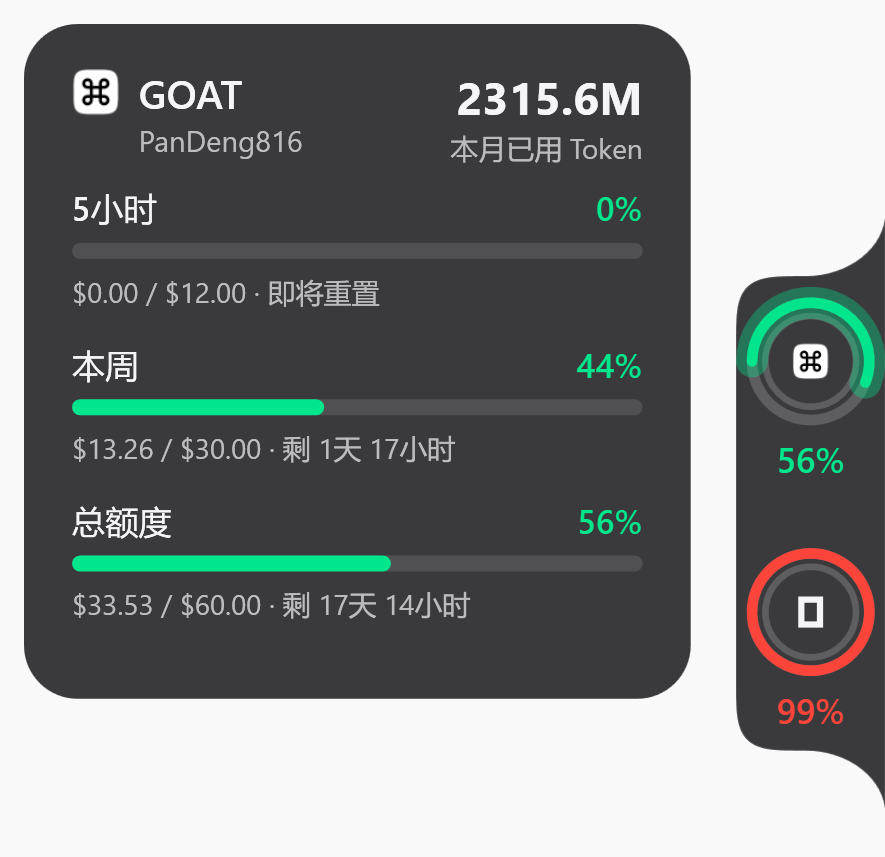
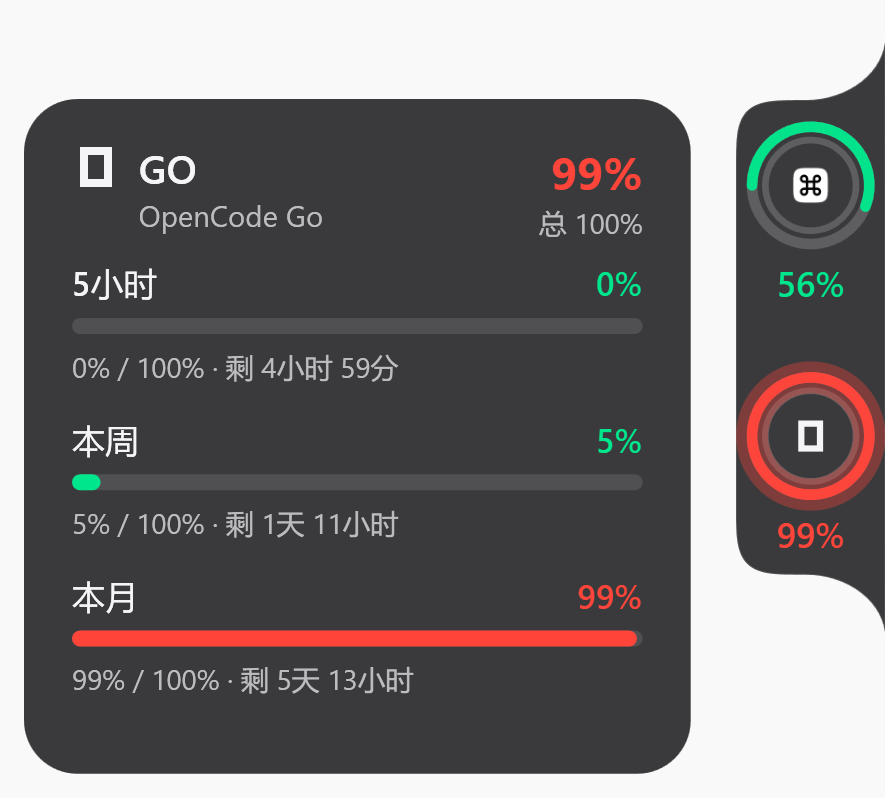
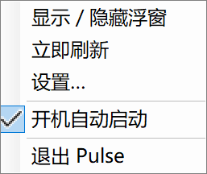
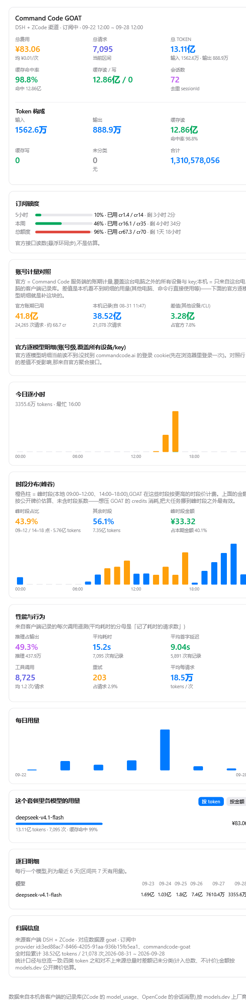
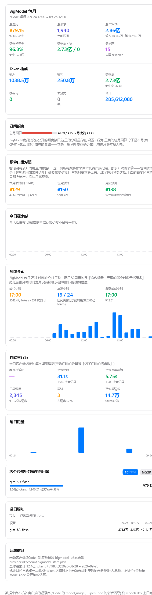
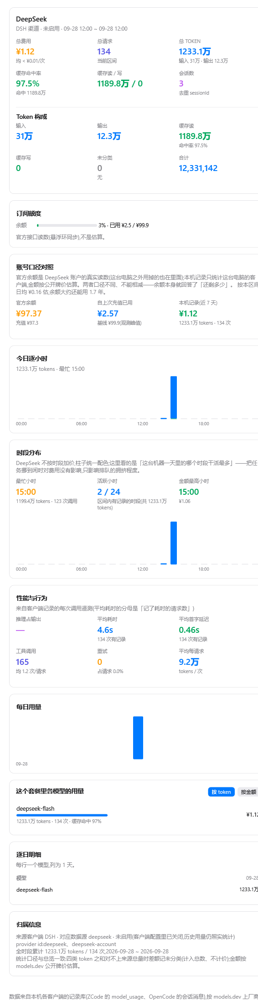
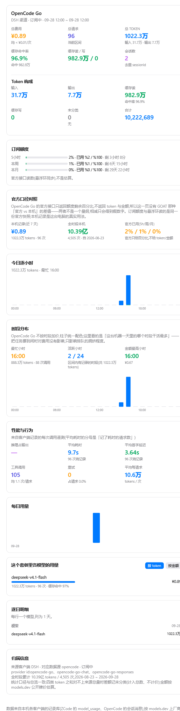

# Pulse for Windows

一个 Windows 11 屏幕边缘的 AI 额度浮窗:黑色玻璃 rail 上,每个订阅一个
**复合同心环**(内细圈 = 5 小时用量,外粗圈 = 月总额度),用量 ≤80% 绿色、
>80% 红色报警;hover 弹出三池明细卡。数据源:Command Code GOAT、OpenCode Go
(支持多个账号/工作区,每个工作区一个环,未订阅的显示为灰环)与 DeepSeek(余额),
自动 60 秒同步,不依赖任何第三方服务。

> ### ✅ 已适配 DSH(DeepSeek Harness)桌面版
>
> **DSH 的用量与"正在跑"状态,在这里都能看到**:
>
> - **用量统计**直接读 DSH 的会话记录(`~\.dsh\sessions\` 的 zstd 事件流),按每一步的
>   token 明细入账,和 ZCode、OpenCode 并列成"来源"三行;套餐页里 DSH 消耗自动归到它
>   实际走的那个套餐(如 Command Code GOAT),与 ZCode 同页合账——**本机账单里不再有
>   "看不见的那一块"**。
> - **子代理会话归根**:DSH 每派一个子代理就起一个独立会话,PulseWin 会把它归回派它的
>   那个主任务,"最近会话"不再被拆成一堆看起来互不相干的任务。
> - **环心呼吸**:DSH 正在跑一轮、且这一轮实际烧到某个源的通道时,那个源的环心图标会轻轻呼吸(与 ZCode 的判定并列;按通道判定,v1.16.1 起)。
>
> 不装 DSH 也不受任何影响:没有 `~\.dsh` 目录时这一路来源自动缺席,不报错、不占资源。

展示层还原自 [qunqin24/Pulse](https://github.com/qunqin24/Pulse)(macOS),
数据层移植自
[ahuud251/goat-go-usage-monitor](https://github.com/ahuud251/goat-go-usage-monitor)。
见 [THIRD-PARTY-NOTICES.md](THIRD-PARTY-NOTICES.md)。

## 预览

贴边 rail 上的复合同心环:内细圈 = 5 小时用量,外粗圈 = 月总额度;
阈值内绿色,超过报警线转红(下例中 GOAT 56% 绿、OpenCode Go 99% 红)。
鼠标悬停弹出该订阅的明细卡——三个时间池各自的百分比条、已用量与重置倒计时:

| Command Code GOAT 明细卡 | OpenCode Go 明细卡 |
|---|---|
|  |  |

托盘右键菜单:显示/隐藏浮窗、立即刷新、设置、开机自动启动、退出:

<p align="center"></p>

## 下载

**免安装**:到 [Releases 页面](https://github.com/PanDeng816/PulseWin/releases/latest)
下载 `PulseWin.exe`,双击即用(自包含单文件,无需安装 .NET)。
数据保存在 exe 同目录的 `Data\` 下,卸载 = 删除整个文件夹。

## 功能

- **支持的客户端**:**DSH(DeepSeek Harness)**、**ZCode**、**OpenCode** 的本地用量
  都能统计(见下文"用量窗口");额度环读的是各订阅/账号的官方接口
- 屏幕右/左/上边缘停靠或自由浮动;鼠标探到边缘滑出,移开 0.9s 自动隐藏
- **空闲时几乎不耗电**:主循环按需在 60fps(有动画/指针在 rail 上)与 10fps(静止)
  之间切换,静止藏屏外时一帧都不重绘——实测 idle CPU ≈ 0%、私有内存约 175MB
- **工具窗按需读取、用完即还**:套餐用量页与用量统计窗共用**同一份账本**(引用计数,
  谁都不用了立刻释放),不再各读一遍本机两个库;关掉窗口后内存随即回落
- 每订阅一个复合环:内圈 = 5小时用量,外圈 = 月总额度(周额度在 hover 卡内)
- **只在有用量时显示 5 小时圈**(默认开):5 小时窗口没用过的源**只画总额度外环**——
  大多数源的 5 小时窗口长期是 0%,那一圈空轨道只增加噪音;省掉之后,"内圈出现"
  本身就是"这个源正在被用"的信号,rail 一眼看过去干净很多。可在设置里关掉退回"总是两圈"
- DeepSeek 是**余额型**数据源,只占一圈:要么按所选基准画百分比,要么直接显示
  余额金额(详见下文)
- **环尺寸固定、显示哪些源可选**:设置里勾选要显示哪几个;关掉的既不显示、不占高度,
  **也不再对它发请求**(不是"照旧每 60 秒打一次接口、只是不画环")。多一个源 rail 就长
  一截,环本身不缩
- **读数可隐藏**:关掉后 rail 是一条纯环列,环间距与整体高度同步收窄
- 报警线(默认 80%,可调):阈值内绿、超过转红、封顶深红
- hover 卡片:三池各自的百分比条、已用量、重置时间;数据超过 3 分钟没更新时
  会标出"⚠ 数据 X 分钟前 · 未能刷新"
- 点击环 = 立即刷新(真的会打一次接口,弧变暗 + 亮段游走直到数据回来;亮段**至少
  显示 650ms**,免得一闪而过让人以为没刷)
- **rail 上点右键 = 菜单**(显示/隐藏、立即刷新、用量统计、设置、退出):命中范围与
  拖动完全一致,所以**能拖动的地方就能右键**;菜单每次点击现构建,刚查到的新版本
  立刻就在里面
- **环心呼吸 = 哪个源在被烧,哪个环呼吸**(v1.16.1 起按通道判定):有客户端在跑一轮、
  且这一轮的通道确实烧到某个源的时候,**那个源**的环心图标会轻轻呼吸
  (缩放 92%~100%,约 1.2 秒一轮)。通道从 ZCode 日志 model 系事件的 `providerId`
  (BigModel 直连/GOAT/OpenCode Go 各有各的 id)与 DSH 投影的 `modelSelection`
  读出,经 `ChannelRegistry` 映射到源——ZCode 走 BigModel 直连时谁的环都不动,
  早期的"客户端在跑就呼吸 GOAT"只在那两个客户端只走 GOAT 的年代成立。
  "在不在跑"的判定:ZCode 读它自己应用日志里 `turn.started` 与
  `turn.completed` / `turn.failed` 的配对——**不是"最近若干秒有写入"**:跑长命令时
  它误灭、回合结束后又会因为客户端继续写记账信息而永远亮着。等待超时按"这一轮在等
  什么"分档(等工具 5 分钟、等模型 90 秒)。DSH 的判定读它的会话投影
  (`~\.dsh\storages\session_projcache\` 里的 `openTurnStartSeq` 有没有闭合),
  同样带 5 分钟门限——异常退出会留下一个永不闭合的回合,没有门限它就会一直亮着
- **5 小时内圈只在"正在使用"时出现**(v1.16.1 起按"此刻正在被烧"判定,设置里可关):
  早期用"5 小时窗口 Used>0"近似"正在使用",但窗口是滚动的——停用之后好几个小时内
  内圈一直挂着,和"正在用"不是一回事。现在停用即收起,内圈出现就表示这个源此刻正在被用
- **至少保留一个数据源**:取消最后一个勾选时会自动弹回并说明原因——三个全关之后
  浮窗上就什么都没有了
- **每个源可自定义圆环颜色**(`#RRGGBB`):不填就还是"按用量着色";用满时一律深红
- **自动检查更新**:每两小时查一次 GitHub Release,**只提示、不自动安装**
- **用量窗口**(托盘右键 → 用量):见下文
- 托盘:**常驻品牌图标**(v1.12.2 起不再画额度小环——任务栏里认不出是什么程序),
  悬停显示各源摘要;双击显示/隐藏、右键菜单(立即刷新、用量、设置、开机自动启动、退出);
  额度越线时弹告警气泡
- 只允许运行一个实例:重复启动会唤醒已有窗口,不会起第二个浮窗

## 额度口径(GOAT)

Command Code 的服务端只发**剩余额度**、不发上限,而且 GOAT 的额度单位是
**credits(用量价值单位)而不是美元**,池子是固定的 70 credits:

```
月上限 = 70 credits(5小时 cap 14、周 cap 35 正是它的 20%/50%,同一刻度)
已用   = 70 − 服务端 remaining
百分比 = 已用 / 70                # 只依赖固定池子,与所选模型无关
```

界面上一律显示 **credits 原值 + 百分比,不做美元折算**。"1 credit 值多少美元"要先
知道所选模型的 monthly allowance,而那是官方随时会调的数(V4.1 Flash 常态 $40,
2026-09-11~09-20 曾限时提到 $60,之后又回落),换个模型也会变。把显示建立在这个数上,
官方一调、或换一个 allowance 不同的模型,同一份服务端数据就会被折成另一个金额,
切换日还能看到"已用"凭空跳变——那就不是服务端给的原始事实了。参见
`Services/CommandCodeApiClient.cs` 里的 `CreditUnit`。

**高峰/低谷已自动计入**:服务端按请求发生时刻的实际单价扣 credit(高峰价是错峰的
2 倍),所以高峰时段额度掉得更快——百分比本身就是"实际花费"的口径,工具无需额外换算。

## 余额口径(DeepSeek)

DeepSeek 和另外两个源的根本差别:**它卖的是预付余额,不是套餐**。接口只有一条,
而且是官方文档里的:

```
GET https://api.deepseek.com/user/balance
→ {"is_available": true, "balance_infos": [{"currency":"CNY","total_balance":"110.00",
   "granted_balance":"10.00","topped_up_balance":"100.00"}]}
```

回包里**没有额度、没有窗口、没有重置时间**,API 里也没有消费历史。所以"环"要画
百分比就缺一个分母,本程序给三个来源,在设置里选:

| 基准 | 分母 | 环上显示 |
|---|---|---|
| **自上次充值**(默认) | 本程序观察到的历史最高余额 | `(峰值 − 余额) / 峰值` → 百分比 |
| 只看余额 | 没有 | 不画百分比,直接显示 `¥42.3` |
| 我的预算 | 你填的"满箱"金额 | `(预算 − 余额) / 预算` → 百分比 |

默认用"自上次充值",因为它的分母是**观察出来的**而不是猜的:余额上涨只可能是充值,
所以一涨就把峰值重置回满。代价是首次运行没有历史峰值,环从 0% 开始,直到真的花了
钱——那是关于"本程序看到了什么"的真实陈述。峰值按**币种**各存一份
(`Data\deepseek-baseline.json`),因为一个账户可以同时持有 CNY 和 USD,两者不能相加
也不能跨币种比大小。

另外两条口径:环上的金额用**截断**而非四舍五入的短写法(显示得比实际多是错错了
方向),精确值在 hover 卡里;只有 DeepSeek 自己的 `is_available` 能表示"账户花光
了",自设预算走到 100% 不算——那是你画的线,不是 DeepSeek 的判定。

### 卡片里的"今日消耗"柱状图

DeepSeek 的 API **不提供任何用量或消费历史**,所以拿不到真实的 token 数。卡片上
那张柱状图是本程序**自己观察**出来的:每次同步成功记下余额(每小时留一个点),相邻
两个小时的差额就是那一小时的消耗。

也就是说它衡量的是"余额下降",不是账单。**程序没运行的那些小时没有采样,柱子上是
空的**——宁可缺一根柱子,也不能把"没看见"画成"没花钱"。数据按币种分开存
(`Data\deepseek-ledger.json`,保留最近 7 天),余额上涨(充值)的那一小时记 0。

卡片脚注同时给出 `topped_up_balance` / `granted_balance` 的拆分(这是 DeepSeek 回包
直接提供的),所以能一眼看出余额里有多少是自己充的。

## 用量窗口(v1.12 起合并了原"套餐用量"页)

托盘/悬浮环右键 → **用量**,设置 → 数据源 → **打开用量窗口**,或给 exe 加
`--spend-window` 参数。一个窗口三层:**顶部订阅额度条**回答"还剩多少、什么时候重置"
(管理),**总览页**回答"这段时间的活干到哪儿去了"(分析),**套餐页**看单个套餐的
完整画像(下钻)。它自成一体的窗口,不在 rail 上:这是坐下来看的东西,不是瞥一眼的东西。

**数据从本机来,不发任何请求**:

| 来源 | 读什么 | 粒度 |
|---|---|---|
| ZCode | `~\.zcode\cli\db\db.sqlite` 的 `model_usage` 表(连 `session` 取项目/标题) | 每次请求 |
| OpenCode | `~\.local\share\opencode\opencode.db` 的 `message` 表(助手消息里的 `tokens`) | 每条消息 |
| DSH | `~\.dsh\sessions\<工作区>\<会话>\session.v4.jsonl.zstd` 的 `assistant/message` 事件(带 zstd 解压 + 文件级缓存) | 每一步模型调用 |

**DSH 的子代理会话会归根到主会话**。DSH 每派一个子代理就起一个独立会话(自己的会话文件、
自己的标题,如"任务: 把 `D:\…\05CADTools`…"),父子关系记在**父会话**的
`subagent/catalog` 事件里(`childId`)。PulseWin 沿这条线索把子会话的用量、项目、标题
都换成它所属的主会话的——否则"最近会话"会被拆成一堆看起来互不相干的任务,而用户认的是
"我开的那个任务"。找不到父(父会话文件已被删)的**原样保留**,不做猜测。
去重键用的是**来源自己的会话号**(不是归根后的分组号),所以归根规则怎么改都不会让
历史明细被重复计数——改这条逻辑时务必保持这个区分。

口径上死守几条规矩(与上游 Pulse 一致),宁可少显示也不显示错的数:

- **四类 token**:输入(新鲜部分)、缓存写、缓存读、输出。**分类之和必须能对上来源
  报告的总量**——对不上的差额进"未分类",计入总数但**绝不塞进输入、也绝不参与计价**。
  (ZCode 的 schema 里 `input_tokens` 含缓存、`output_tokens` 含推理,所以输入侧要减掉
  缓存重叠、推理不再加第二次;OpenCode 的 `reasoning` 则要并进输出;**DSH 的
  `inputTokens` 本来就是"未命中缓存的输入"**(它的会话投影里叫 `uncachedInputTokens`)、
  `cacheWriteTokens` 恒为 0,所以四类直接取用、不要做减法——这两家的口径正好相反,
  改读取器时务必分清。)
- **金额一律来自牌价**,不用来源自己记的 `cost` 字段(那是它当时的理解,套餐没价目时
  就是 0)。牌价取自 [models.dev](https://models.dev),**第一方厂商价永远优先**,查不到
  才退到套餐价(如只在 `opencode-go` 上架的 `deepseek-v4.1-flash`)。
- **查不到价的模型只计 token、不显示金额**,并明确标出来——一个猜出来的价格看起来
  像对的数字,比没有更糟。列表里金额显示 `—` 是"算不出来"(不是"没花钱"),带 `*` 的是
  **只覆盖有价部分的小计**;真实 0 元的免费模型照旧显示 `$0.00`
- **牌价表会自己更新**:内置那份是打包时的快照,过期(超过 7 天)之后打开统计窗口会在
  后台拉一份新的 models.dev 全量、按厂商白名单裁剪后写进 `Data\model-prices.json`,
  下一次读取即生效;**失败就继续用旧的**,五分钟后再试。只收模型原厂与在售套餐厂商,
  两百多个转售商一个都不进(否则转售商会按字母序抢在原厂前面决定价格)
- **项目身份与显示名是两件事**:项目的身份是完整工作目录——`D:\work\a\api` 与
  `D:\work\b\api` 是两个项目,用量不会并成一行;显示时默认只给末段目录名,末段撞名
  才往上补一段(如 `06Learning\03_工作资料`)。逐日聚合存在本地仓库
  (`Data\usage-history.sqlite`),源库清理旧记录之后历史还在
- **读不出来的来源要说出来**(库被锁、结构变了),而不是当成 0。
- **金额是按公开 API 价折算的估算,不是账单**;套餐内调用看起来"很便宜"是因为套餐
  已经把边际成本预付掉了。

区间可选 今天 / 近 7 天 / 近 30 天 / **自定义**(起止日期)/ 全部(默认近 7 天),
换区间只重算加法,不重读库。总览页还有:

- **订阅额度条**:每个订阅一行(5 小时 / 本周 / 总额度进度 + 已用金额 + 重置倒计时),
  读的是悬浮环同步好的官方接口数字;BigModel 没有用量接口,显示"本月估算金额 + 月底
  预测",在设置里填了包月预算(`BigModelMonthlyBudgetCny`)才有进度条——这一行**只算
  BigModel 自己**的本月用量,不把 GOAT/DeepSeek 的花费混进来
- **环比**:大卡上一行"较上一周期 tokens +x% · 金额 +x%",自动取等长的上一周期
- **点击下钻**:每日柱图的柱、活动热图的格子都能点——点某天,整个窗口切换成那天的
  数据(面包屑"← 返回"退出);天数多于 62 天时柱图自动按周聚合、多于 730 天按月
- **导出**:右上"导出"按钮,当前区间导出 CSV(Excel 直接打开,带 BOM)或 JSON,
  含逐日 / 模型 / 项目 / 会话四张表与口径说明
- **额度告警**:某个额度池的用量从阈值(rail 转红那一档,默认 80%)下方穿到上方时,
  托盘弹一次气泡(重置或降下去后再次跨越才会再报)

## 套餐页(用量窗口内)

用量窗口顶部 tab 选套餐(原来在设置里,v1.12 搬了进来)。每个套餐一页,都是完整画像:

- **套餐切换**:Command Code GOAT / OpenCode Go / BigModel 包月 / DeepSeek … 各一个按钮,
  按钮上带该套餐的总量。同一个套餐的多种 provider 写法会**合并成一个**
  (OpenCode Go 的 `opencode-go` / `-glm` / `-responses`,BigModel 的 `builtin:` 与 `account:`);
  **按钮顺序 = 本区间用量降序**(用量相同按名字定序),配置里存在但这段没用过的套餐排在最后
- **订阅过、这段没用过的套餐也一直在**:凡是客户端配置里存在的套餐都会列出,
  本区间零用量的会标"本区间无用量"并显示最后使用日期(`未启用` 表示客户端配置里关着,
  历史用量仍照实统计)——不会因为"最近没续订"就从列表里消失
- **KPI 六格**:总费用(含均价/次)、总请求、总 TOKEN(含输入/输出)、缓存命中率(含命中量)、
  缓存读 / 写、会话数
- **Token 构成六格**:输入 / 输出 / 缓存读 / 缓存写 / 未分类 / 合计
- **订阅额度**(每个套餐都有这一块):有配额接口的渠道(GOAT / OpenCode Go / DeepSeek)
  显示官方池读数——5 小时 / 本周 / 总额度(或余额)的进度与重置倒计时;
  BigModel 没有额度接口,改用**设置里手填的包月预算**当分母,画出本月估算金额的进度与月底预测
- **今日逐小时**:0~23 点的用量柱状图(输入与输出分色堆叠),标出最忙时段;
  **只有按峰谷加价的套餐(GOAT)才把峰时段的柱染成橙色**,别的渠道统一配色
- **时段分布**(每个套餐都有):整个区间的 24 小时分布。GOAT 这类"峰值加价"套餐另外拆出
  峰时段(本地 09:00–12:00、14:00–18:00)占了多少 token 与金额——想压 credits 消耗,
  把大任务挪出峰时段最有效(金额按公开牌价估算、未含时段系数);
  不按时段加价的渠道改为给"最忙小时 / 活跃小时数 / 金额最高小时"
- **每日用量**:区间内逐日柱状图(没有记录的那天画一条淡线,不是 0)
- **性能与行为**(来自客户端记录的每次调用遥测):推理占输出、平均耗时、平均首字延迟、
  工具调用(含次数/请求)、重试(含占比)、平均每请求 token
- **这个套餐里各模型的用量**:模型 + 占比条 + 总量 / 次数 / 缓存命中率 + 估算金额,
  右上角可切"按 token / 按金额"排序(单价差几十倍,按 token 排会误导)
- **官方口径对照**(每个套餐都有,内容按这个渠道**真能拿到的官方读数**生成):
  - **GOAT**:官方账期已用 token/请求/费用 vs **本机记录(同账期)** vs 差值——
    官方数字覆盖**所有设备、所有 key**(服务端计量),本机只有这台电脑的记录,
    差值就是其他设备/命令行直接使用的量(v1.12.1 实测:官方 37.4 亿 vs 本机 34.2 亿,
    差 3.2 亿来自其他设备)。账期起点 = 月池重置时间往回 30 天
  - **DeepSeek**:官方余额 / 自上次充值已用 / 本机区间记录 —— 余额是账户真实读数,
    本机金额是按牌价估的,两者口径不同、**不能相减**,所以直接给"按当前日均还能用多久"
  - **OpenCode Go**:本机区间记录 / 全时段本机 / 官方已用(5h·周·月百分比);
    开了「浏览器会话明细」后追加**官方口径对照**——服务端明细(近 30 天、按工作区、
    覆盖所有设备与 key,跟网页版一个口径)vs 本机同窗口,差值即其他设备,附官方逐模型榜。
    官方只回百分比、不给 token 与金额,相减只会得到假数字,所以这里如实说明口径差异
  - **BigModel 包月**:本月估算 / 包月预算 / 月底预测(智谱没有公开接口)
- **官方逐模型明细(账号级,仅 GOAT)**:调 `/internal/usage/charts`(浏览器登录态),
  跨设备按模型看 token 构成——需要 设置 → 数据源 打开「浏览器会话明细」并备好登录会话
  (见下文「浏览器会话明细」一节);读不到时自动隐藏、不影响对照行
- **逐日明细**:每行一个模型、每列一天(最近 6 天)的 token 矩阵,悬浮看当天次数与金额
- **归属信息**:实际用到的 provider id、来源客户端、与统计窗口一致的口径说明

**四个套餐页的结构是一致的**(v1.14.0 起):订阅额度 / 官方口径对照 / 时段分布这三块
**每一页都有**,内容按该渠道真能拿到的官方读数生成——下面是四页的实测出图
(`--ui-shot` 逐个 tab 各出一张):

<p align="center">
  
  
  
  
</p>

区间与总览共用一套(今天 / 7 天 / 30 天 / 自定义 / 全部)。数据来源同源(本机
ZCode / OpenCode 记录库,不发请求),口径也完全一致:四类 token 之和对不上来源总量时
差额记"未分类"(计入总数、不计价),金额按 models.dev 公开牌价估算。

设置 → 数据源里现在只留"用量数据"入口按钮和"浏览器会话明细"开关;用量展示本身
全部在用量窗口里。

### 套餐是怎么认出来的

本机用量记录里只有 `provider_id`(ZCode 是 UUID 或 `builtin:xxx` 这类字符串,
OpenCode 是 `opencode-go`),直接拿来当分组键会显示成没人看得懂的一串。
`ChannelRegistry` 把 id 翻成套餐名:**优先读 ZCode 自己的 provider 配置**
(`~\.zcode\v2\provider_config.json` 里有 providerId→providerName 的权威映射),
读不到再退回内置规则(opencode-go-* 前缀、bigmodel-* 前缀等)。
两者都认不出的 id 会原样显示成短标签,**宁可不认识也不丢数据**。

**DSH 走的是内置规则**:它记下来的 provider 是**路由名**(在
`~\.dsh\profiles\<profile>\cordis.patch.yml` 里自定义,如 `commandcode-goat`),
不是配置里能查到的 id。所以 `commandcode*` / `goat` / `deepseek` 这几个前缀都显式
归了档——不归的话会多出一行"渠道 commandco",而 DSH 花的钱其实正是 GOAT 那份额度,
两行会让人以为金额对不上。

### 可选:浏览器会话明细(默认关;账号级跨设备明细)

这一页有一个**浏览器会话明细**开关,开了之后去抓只有登录态才开放的官方接口
(Command Code 的逐模型缓存明细、OpenCode 的额度口径与逐请求明细),与本机库的记录
做交叉核对、并让 OpenCode 的额度显示精度到分。

**登录会话怎么来**(v1.18.0 起):设置页点 **「登录 opencode.ai」**,弹一个**内嵌 WebView2**
的浏览器窗,用 GitHub 或 opencode 账号登一次即可——cookie 由浏览器引擎直接给出(已解密、
HttpOnly 也拿得到),DPAPI 加密保存在本机,之后长期复用。命令行 `--login-opencode` 是同一个窗。

**为什么不用"自动读本机浏览器 cookie"**:那条路已经不通了。Chromium 系(Edge/Chrome 127+)
的 cookie 由 **App-Bound Encryption** 保护(`v20` 前缀),密钥按浏览器可执行文件路径绑定、
由浏览器自己的提权服务解封,第三方进程解不开——不是"浏览器运行时文件被锁"那么简单,
把浏览器全关掉读出来也一样是 `v20`。所以自动读取现在只作兜底尝试,读不到会明确告诉你原因。
读不到的窗口,还可以在设置页**手动粘贴会话 cookie**(DevTools → Application → Cookies 里的
`__Host-console_session`,老账号是 `auth`)。

**默认关**的理由:读 cookie 这类行为**可能被杀毒软件误判**。同类工具 CodexBar-Win 就因为
"解密浏览器 cookie 读配额"被 AV 全家误判成 infostealer,最后撤掉了全部二进制。这是真实前车之鉴。

**官方明细现在是一点就出**:OpenCode 的用量读数取自控制台用量页自己读的那三个**聚合**接口
(`/console/api/usage/{summary,models,cost-by-day}`,账号级、覆盖所有设备与 Key),三条请求
加起来不到一秒。结果**内存 + 落盘缓存 15 分钟**(`Data/opencode-usage-stats.json`)——
切页、切区间、重开应用都走缓存,顶部「重新读取」强制重抓;联网失败时退回上次的读数并标注它有多旧。

> 早先版本读的是 `request-logs`(逐请求明细):那是**游标串行翻页**、100 条/页,重度账号实测
> **117 页 / 353 秒**,而界面上标着"近 30 天"却根本翻不完——40 页上限只够最近两三天,报出来的
> 数字(1.77 亿 tokens / $2.58)只有真值(5.5 亿 / $9.65)的三分之一。换聚合接口后,"数据不对"
> 和"每次都要等"两个问题一起消失。

官方金额是**服务端的真实计费**(含峰谷时段价);本机金额按公开固定牌价估算、
不含时段系数,两者不是同一个口径。对照卡里的「差值」回答的是"这台电脑之外还用了多少"。

悬浮卡头部也会像 GOAT 那样直接显示官方账期 token(如 `570.0M · 本月已用 Token`)——
百分比回答不了"一个月能用多少 token",这个数才回答得了。

**不开这个开关,套餐页也完整可用**(本地库本来就有逐模型的 token 与缓存读/写)。

## 运行

需要 Windows 10/11。两种方式:

```powershell
# 开发运行(需 .NET 8 SDK)
dotnet run

# 单文件成品(自包含,免安装)
dotnet publish -c Release -r win-x64 --self-contained true `
  -p:PublishSingleFile=true -p:IncludeNativeLibrariesForSelfExtract=true `
  -p:EnableCompressionInSingleFile=true -o publish
.\PulseWin.exe
```

`EnableCompressionInSingleFile` 把自包含产物从 ~154MB 压到 ~70MB,代价是首次
启动多花一点解压时间。日常使用的 `PulseWin.exe` 放在仓库根目录,便携数据
`Data\`(凭据/用量历史)必须与它同目录,挪 exe 时记得一起挪。

**根目录那份是"框架依赖单文件"**(约 3 MB,机器上要有 .NET 8 桌面运行时):

```powershell
dotnet publish -c Release -r win-x64 --self-contained false `
  -p:PublishSingleFile=true -p:IncludeNativeLibrariesForSelfExtract=true -o <输出目录>
```

体积小、启动快,适合自用;上面那个自包含版是给没装运行时的机器与 Release 用的。
注意 `EnableCompressionInSingleFile` **只在自包含时才支持**(框架依赖下会报 NETSDK1176)。
`--self-contained false` 也必须带 `IncludeNativeLibrariesForSelfExtract`——
用量统计要读 SQLite,它的原生 `e_sqlite3.dll` 打包进单文件后要靠自解压才找得到。

几个**只输出结果、不开界面**的诊断参数(走的是与界面完全相同的那套口径代码):

| 参数 | 作用 | 输出 |
|---|---|---|
| `--spend` | 把用量统计的原始数字打出来(核对口径用,别靠截图) | `Data\spend-dump.txt` |
| `--models` | 把逐模型聚合、套餐/渠道聚合与浏览器会话通道的状态打出来 | `Data\models-dump.txt` |
| `--dsh` | DSH 读取器的解析结果、冷/热耗时、缓存命中,以及**与 DSH 自己的会话投影逐会话对账** | `Data\dsh-dump.txt` |
| `--update-prices` | 强制更新一次模型牌价表并等它做完 | `Data\price-update.txt` |
| `--activity [目录]` | 读 ZCode 活动日志(可指定目录)与 DSH 会话投影,输出"现在算不算在跑"的判定 | `Data\activity.txt` |
| `--card-shot` | 用合成数据把 hover 明细卡离屏渲染成 PNG(排版必须在像素上核对) | `Data\card-shot\*.png` |
| `--ui-shot` | 把设置窗各页、环色选择器与用量窗口离屏渲染成 PNG(不 Show、不抢焦点);用量窗口**逐个视图 tab 各出一张长图**(总览 + 每个套餐页),便于并排核对"哪一页少了哪块" | `Data\ui-shot\*.png` |
| `--check-migration` | 核对旧设置能正确迁到新格式(用合成用例 + 本机真实 settings.json) | `Data\migration-check.txt` |
| `--rail-shot` | 用合成数据把 rail 主界面离屏渲染成 PNG(验证"空闲只画外圈"这类绘制改动) | `Data\rail-shot\*.png` |
| `--rail-real` | 同上但**用真实快照**(不注入),验证 `LoadAll` 的真实加载路径(含附加账号按实例键展开) | `Data\rail-shot\rail-real.png` |
| `--opencode-session` | 真实走一遍 OpenCode 浏览器会话通道(读 cookie → 工作区列表 → 服务端明细),聚合结果落盘;不受「浏览器会话明细」开关限制 | `Data\opencode-session.txt` |
| `--go-meters` | 真实走一遍**网页口径额度**通道(读 cookie → 工作区列表 → `go/status`),把每个工作区的 meters 原值、网页百分比与 API Key 口径并排打出,并附一段**离线自测**(合成响应验证解析与公式、工作区指纹匹配) | `Data\go-meters.txt` |
| `--login-opencode` | **唯一会开界面**的参数:直接弹内嵌浏览器登录窗(与设置页「登录 opencode.ai」是同一个窗口)。平时从设置页进,这个用于已有实例在跑时补一次登录 | 无(是界面) |
| `--login-commandcode` | 同上,登录 commandcode.ai(设置页「登录 commandcode.ai」的同一个窗口) | 无(是界面) |

> 关于 `--go-meters` / `--opencode-session` / `--models`:它们要读官方站的登录会话。**直接读本机
> 浏览器的 cookie 库已经不通了**——Edge/Chrome 127+ 的 cookie 用 App-Bound Encryption
> (`v20` 前缀)保护,密钥按浏览器可执行文件路径绑定,第三方进程解不开。请先在设置页点
> 「登录 opencode.ai」/「登录 commandcode.ai」登一次(内嵌 WebView2,引擎直接给出已解密的
> cookie),或手动粘贴会话 cookie。**API Key 仍然必需**——联网页会话只是补明细/提精度,
> OpenCode 的额度还靠它做工作区指纹匹配,GOAT 的额度则只有 API 能读。

## 设置与数据

托盘 → **设置…**:
- 显示各数据源的连接状态与凭据来源
- 可手动输入 API Key(先联网验证,通过后 DPAPI 加密保存并立即同步)
- **OpenCode Go 多账号**:设置 → 数据源 → OpenCode Go 卡的「账号(工作区)」区块。
  OpenCode 的每个工作区(官方控制台里的 go1/go2…)是一把独立的 API Key、一个独立的
  额度池——主账号自动读取本机登录态;其他工作区点「添加账号」粘入它的 Key 并起个名,
  rail 上就多一个环、额度条上多一行。**未订阅的工作区也能先加**:显示为灰环,开通
  订阅后自动开始同步。每个账号可单独改名/控制显示/删除(Key 随之从本机清除)。
- 调整显示与刷新偏好,即时生效并写入 `Data\settings.json`:
  - **报警阈值**(50%~99%,默认 80%)
  - **背景不透明度**(30%~100%,默认 80%)
  - **同步间隔**(15~300 秒,默认 60 秒)
  - **显示哪些圆环**(至少留一个)、**环下是否显示读数**
  - **只在有用量时显示 5 小时圈**(默认开;关掉退回"总是两圈")
  - **圆环顺序**:在「行为」页用**可重排列表**调整(拖动行首手柄或点上下箭头)
  - **每个源的圆环颜色**(留空 = 按用量着色)
  - **自动隐藏**的两个开关(见下)
  - **网络代理**(跟随系统/直连/手动 HTTP;**重启后生效**)

### 加一个新的数据源

数据源是一张注册表(<see>`Services/SourceCatalog.cs`</see>)驱动的,加一个源只需**加一条记录**
(键、显示名、rail 标题、月池叫法、是否余额型、快照/凭据文件名、凭据提示),不再需要改六处:

```csharp
new(
    Id: MonitorSource.YourSource, Key: "yoursource",
    DisplayName: "Your Source", RailName: "YS", MonthlyLabel: "本月",
    IsBalance: false, CredentialHelp: "…",
    SnapshotFile: p => p.YourSnapshotFile,
    CredentialFile: p => p.YourCredentialFile),
```

设置存取(可见源与顺序)、快照加载、引擎同步、设置页的凭据卡与环色项都从这个表生成。
UI 只保留三处**与实例绑定**的映射(状态对象、凭据解析器、API 客户端),那是注册表不该持
有的有状态对象。旧设置里的 `ShowGoat`/`SourceOrder`/`GoatTint` 等字段仍能被读入并迁移
(见 `--check-migration`),存量用户升级不丢配置。

**注意上面这张表管的是"额度源"(rail 上画环的那些)。用量统计的来源是另一套**
(`Services/Spend/` 下的 `IUsageStore`),两者互不相干:DSH 就不是额度源(它的额度
属于 GOAT 池),但它是一等公民的用量来源。用量来源有两种形状:

- **别人的运行数据库**(ZCode / OpenCode 的 SQLite):只读打开、查一遍、取
  `session` 表补项目与标题即可;
- **追加写的文件流**(DSH 的 zstd 压缩 jsonl):要自己处理三件事——①**容错解压**
  (活动会话随时可能只写到半个 zstd 帧,读到哪算哪,下一轮长度变了再重读补齐)
  ②**文件级缓存**(历史会话内容永远不变,按"长度 + 修改时间"命中就复用,否则每次
  打开用量窗都要把全部会话重新解压一遍)③**整份解析完再回填元数据**(会话标题、
  工作目录都可能在消息之后才出现,边读边填会让前面的记录没有标题)。

### 关于"液态玻璃"(v1.7.3 已移除)

v1.7.0 曾加过一个"液态玻璃"开关(用 `SetWindowCompositionAttribute` 开系统 acrylic 模糊),
**v1.7.3 已整体删除**。原因是它带来两个无法调和的代价,而视觉收益几乎为零:

- 模糊区域只能是**整个窗口矩形**,跟不了 rail/卡片的圆弧轮廓 —— 一开就把所有圆角变成直角
  (v1.7.0 与 v1.7.1 因此被连否两次)。
- 在分层窗口上调用它会**不可逆地打坏 per-pixel alpha**,圆角与半透明一起失效 ——
  v1.7.2 修的"圆弧和透明度都没了"就是它(`ACCENT_DISABLED` 也会打坏)。
- 实际观感只是 80% 黑 tint 平铺一块,在浅色桌面上看不出"玻璃"。

面板本来就是自绘的黑色玻璃(背景不透明度可调),不需要系统模糊。

### 关于"自动隐藏"的两个开关

- **隐藏时收成贴边小条**:关闭(默认)时,不用就把整条 rail **完全滑出屏幕外**;
  打开则只折叠成贴在屏幕边缘的 6pt 细条(有源越过报警阈值时细条会染色),
  指针靠近热区即展开。
- **全屏时隐藏**:前台是全屏应用(视频/游戏/演示)时自动收起,且**收起期间指针到屏边
  也不会弹出**(否则全屏看视频时鼠标一晃到边缘就被拉出来,这个开关等于没开);
  退出全屏后指针到屏边即可唤回。判定只看"窗口矩形是否盖满显示器",而**桌面
  (`Progman`)与开始菜单/输入体验(`Windows.UI.Core.CoreWindow`)这类系统壳窗口的矩形
  天生就铺满整屏**,所以它们被显式排除;另外"进入全屏"要连续两次判定一致(约 4 秒)
  才生效,退出全屏立即解除并**把 rail 摆回正常隐藏形态**(开了贴边条就能看见那条细边)。

> v1.7.3 修的正是这两个:"收成贴边小条"以前无论开关与否都只在屏边留 6pt
> (既不是细条也没真正隐藏),细条还画在屏外看不见;"全屏时隐藏"收起后热区
> 立刻又能把它拉回来。两个开关现在都真的起作用了。
>
> v1.14.1 又修了"全屏时隐藏"的误判:以前点一下桌面(前台变成 `Progman`)就会被
> 当成"进入全屏",rail 被完全收到屏外,而**收起期间热区是拒绝展开的** ——
> 表现出来的就是"右边整条不见了、鼠标挪到屏幕边缘也不回来",只能靠托盘"显示"
> 救回来(而且 2 秒后又被收走)。另:退出全屏时以前只解除标志、不动窗口,rail 会停在
> 屏外;现在会按正常隐藏形态重新摆一次(贴边条会露出来,一眼能看见它还在)。

凭据自动发现顺序(与 GOAT-Go-Usage-Monitor 一致):
- Command Code GOAT:环境变量 `COMMAND_CODE_API_KEY` → `~\.commandcode\auth.json` → DPAPI 手动存储
- OpenCode Go:环境变量 `OPENCODE_GO_API_KEY` → `~\.local\share\opencode\auth.json` 中 opencode-go 登录态 → DPAPI 手动存储
- DeepSeek:环境变量 `DEEPSEEK_API_KEY` → DPAPI 手动存储。它没有可借用的 CLI 登录态
  (Key 只存在于 DeepSeek 控制台),所以没配 Key 时这个环不显示,也不会拖慢另外两个源
  的刷新节奏

## 隐私

- **无硬编码密钥、无遥测、无第三方服务器**:请求只发给 Command Code / OpenCode 官方接口
- 所有数据(用量快照、加密凭据、设置)存在 **exe 同目录 `Data\`**(不可写时回退
  `%LOCALAPPDATA%\PulseWin`),首次启动会自动迁移旧
  GOAT-Go-Usage-Monitor 目录的数据
- API Key 用 Windows DPAPI 按当前用户加密(`credential.bin`),只有本机本用户可解密
- 接口异常会记到 `Data\diagnostics.json`(最近 100 条),不含密钥
- 上传/分发源码时请勿包含 `bin/`、`obj/`、`publish/`、`Data/`(见 `.gitignore`)

## 免责声明

非官方社区工具,与 Command Code、OpenCode 及其运营方无隶属或背书关系。
